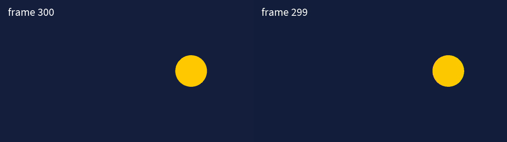

# Processing-NDI

**Send your Processing sketch as live video to other programs, and receive video from them, over your network.**

Processing-NDI is a free library for [Processing](https://processing.org) that speaks **NDI®**, the video-over-network
standard used by OBS, vMix, Resolume, TouchDesigner, Millumin, MadMapper, Isadora and many cameras. If you know Spout
(Windows) or Syphon (Mac), it is the same idea, but it works between different computers too, and on both Mac and
Windows.



What you can do with it:

- **Send** your sketch to OBS to stream it, to Resolume to mix it into a VJ set, or to a projector computer on the other
  side of the room.
- **Send with transparency**: titles, overlays and masks keep their see-through background.
- **Receive** video from other software or from other computers, even several at the same time, and use it in
  your sketch like any other image.

> NDI® is a registered trademark of Vizrt NDI AB. More information about NDI: [ndi.video](https://ndi.video/).
> Processing-NDI is an independent project, not made by or affiliated with Vizrt NDI AB.

---

## Contents

1. [What you need](#1-what-you-need)
2. [Install the library](#2-install-the-library): [macOS](#on-macos) · [Windows](#on-windows)
3. [Check that it works](#3-check-that-it-works)
4. [Send your sketch](#4-send-your-sketch)
5. [Watch it in another program](#5-watch-it-in-another-program)
6. [Receive video in your sketch](#6-receive-video-in-your-sketch)
7. [Examples](#7-examples)
8. [Problems and solutions](#8-problems-and-solutions)
9. [All the commands](#9-all-the-commands)
10. [Update or remove](#10-update-or-remove)
11. [Licence and credits](#11-licence-and-credits)

---

## 1. What you need

| | |
|---|---|
| **Computer** | A Mac with **macOS 13 (Ventura) or newer** (Apple Silicon or Intel), or a PC with **Windows 10 or 11, 64-bit**. |
| **Processing** | **Processing 4**, free from [processing.org/download](https://processing.org/download). |
| **Network** | Only needed to send to *other* computers: they must be on the same network (same Wi-Fi or cable). On one computer, nothing is needed. |

You do **not** need to install anything else: everything NDI needs is already inside the library.

*Optional:* to watch what your sketch sends without other software, you can install the free **NDI Tools** from
[ndi.video/tools](https://ndi.video/tools/) (see [step 5](#5-watch-it-in-another-program)).

---

## 2. Install the library

### On macOS

The quickest way is to copy one line into the Terminal. This downloads the library and puts it in the right place.

1. **Close Processing** if it is open.
2. Open the **Terminal** app. Press `⌘ Command` + `Space`, type `Terminal`, and press `Enter`.
3. **Copy** the whole line below (click the copy button at its right), **paste** it into the Terminal with
   `⌘ Command` + `V`, and press `Enter`:

   ```sh
   curl -L -o ~/Downloads/ProcessingNDI.zip https://github.com/ndev-itservices/processing-ndi-win-mac/releases/latest/download/ProcessingNDI.zip && mkdir -p ~/Documents/Processing/libraries && rm -rf ~/Documents/Processing/libraries/ProcessingNDI && unzip -q ~/Downloads/ProcessingNDI.zip -d ~/Documents/Processing/libraries && echo "Processing-NDI is installed."
   ```

4. Wait until you see **`Processing-NDI is installed.`** This takes a few seconds. Then close the Terminal.
5. Open Processing again, and continue with [step 3](#3-check-that-it-works).

> This line assumes your sketchbook is the usual `Documents/Processing` folder. If you changed the *Sketchbook
> folder* in Processing's settings, use the manual method below.

<details>
<summary><b>Manual method (without the long line)</b></summary>

1. **Download** [ProcessingNDI.zip](https://github.com/ndev-itservices/processing-ndi-win-mac/releases/latest/download/ProcessingNDI.zip).
2. Open your **Downloads** folder and double-click `ProcessingNDI.zip`. A folder called **`ProcessingNDI`** appears.
   Safari may already have done this for you.
3. Find your **sketchbook folder**. In Processing, open **Processing › Settings…** (called *Preferences…* on
   some Macs) and look at *Sketchbook folder*. It is usually **Documents › Processing**.
4. Inside the sketchbook folder, open the folder **`libraries`**. If it does not exist, create it: right-click ›
   *New Folder*, and name it exactly `libraries`.
5. **Drag** the `ProcessingNDI` folder into `libraries`. Inside it you should see the folders `library` and `examples`.
6. **Allow the library to run.** macOS blocks programs downloaded from the internet, and that includes this
   library. Open the **Terminal** (`⌘ Command` + `Space`, type `Terminal`, press `Enter`). Paste this line and press
   `Enter`:

   ```sh
   xattr -dr com.apple.quarantine ~/Documents/Processing/libraries/ProcessingNDI
   ```

   If your sketchbook is somewhere else, type `xattr -dr com.apple.quarantine ` (with a space at the end), drag the
   `ProcessingNDI` folder onto the Terminal window, and press `Enter`.
7. **Restart Processing.**

</details>

### On Windows

1. **Close Processing** if it is open.
2. **Download** [ProcessingNDI.zip](https://github.com/ndev-itservices/processing-ndi-win-mac/releases/latest/download/ProcessingNDI.zip).
3. Open your **Downloads** folder, **right-click** `ProcessingNDI.zip`, choose **Extract All…**, and then click
   **Extract**.
4. A new window opens with a folder called **`ProcessingNDI`**. Open it. If inside there is **another**
   `ProcessingNDI` folder, that inner folder is the one you need. The right folder contains the folders `library` and
   `examples`.
5. Open your **sketchbook folder**. It is usually **Documents › Processing**. To check, open Processing and go to
   **File › Preferences…** and look at *Sketchbook folder*.
6. Inside it, open the folder **`libraries`**. If it does not exist, create it: right-click › *New* › *Folder*, and
   name it exactly `libraries`.
7. **Move** the `ProcessingNDI` folder (the one that contains `library` and `examples`) into `libraries`.
   The result must be: `Documents\Processing\libraries\ProcessingNDI\library\...`
8. Open Processing again, and continue with [step 3](#3-check-that-it-works).

---

## 3. Check that it works

This test sends video and receives it back on the same computer, so you do not need any other software.

1. In Processing, open **File › Examples…**.
2. Open **Contributed Libraries › Processing-NDI › NDI_7_Loopback**. Double-click it.
3. Press **Run** (the ▶ button).
4. The **first time**, your computer asks for permission to use the network. **Allow it**, otherwise NDI cannot work:
   - **macOS** asks whether *"Processing" may find and connect to devices on your local network*. Click **Allow**.
   - **Windows** shows a *Windows Security Alert* for *OpenJDK Platform binary* (or *Java*). Tick **Private networks**
     and click **Allow access**.
5. After a second or two you should see **two identical animations**: on the left the original, on the right the
   copy that travelled through NDI.

✅ If you see both, everything works. ❌ If the right side stays empty, see [Problems and solutions](#8-problems-and-solutions).

---

## 4. Send your sketch

Add **three lines** to any sketch. They are marked with `// ←` in this example:

```java
import processing.ndi.*;          // ← 1. use the library

NDISender sender;                 // ← 2. a sender

void setup() {
  size(1280, 720, P2D);
  sender = new NDISender(this, "My Sketch");   // ← 2. create it and give it a name
}

void draw() {
  background(0);
  fill(255, 200, 0);
  circle(mouseX, mouseY, 100);

  sender.send();                  // ← 3. send what you have drawn, at the end of draw()
}
```

Run it. Your sketch is now visible on the network as **`YOUR-COMPUTER (My Sketch)`**.


**Useful variations:**

- **Send everything automatically.** Instead of calling `sender.send()` in `draw()`, add
  `sender.setAutoSend(true);` once in `setup()`.
- **Send only a layer.** Draw into a `PGraphics` and send it with `sender.send(pg);`. It can be bigger or smaller
  than your window, for example a Full HD 1920×1080 output from a small window.
- **Keep transparency**, for titles or overlays in OBS or vMix: add `sender.setAlpha(true);`, and clear your
  `PGraphics` with `pg.clear()` instead of `pg.background(...)`. See the example *NDI_3_Transparent_Overlay*.
- **Several outputs.** Create several senders with different names. See *NDI_4_Multiple_Sources*.

> **Tip:** the library only works while someone is watching. When no program is receiving your sketch, it uses
> almost no extra power.

---

## 5. Watch it in another program

Run your sketch first, then pick it in the other program by its name, *YOUR-COMPUTER (My Sketch)*:

| Program | Where to find NDI |
|---|---|
| **NDI Tools** (free, [ndi.video/tools](https://ndi.video/tools/)) | macOS: open **NDI Video Monitor** and choose the source from the menu. Windows: open **NDI Studio Monitor**, click the ☰ menu at the top left, and choose your computer › your sketch. |
| **OBS Studio** | Install the free [DistroAV](https://distroav.org/) plugin, then go to **Sources › + › NDI™ Source** and choose your sketch. |
| **Resolume** | **Sources** panel › **NDI**. Drag your sketch into a clip slot. |
| **TouchDesigner** | Create an **NDI In TOP** and choose your sketch in its *Source Name* parameter. |
| **vMix** | **Add Input › NDI / Desktop Capture** and choose your sketch. |
| **Another Processing sketch** | Use `NDIReceiver`, see the next step. |

Sending to **another computer** works the same way, as long as both are on the same network.

---

## 6. Receive video in your sketch

An `NDIReceiver` behaves like a `Movie` or a `Capture` (webcam). It is an image that keeps updating:

```java
import processing.ndi.*;

NDIReceiver video;

void setup() {
  size(1280, 720, P2D);
  printArray(NDI.sources());              // shows the names of all NDI sources in the console
  video = new NDIReceiver(this, "OBS");   // the name of the source, or just a part of it
}

void draw() {
  if (video.available()) video.read();    // get the newest frame
  image(video, 0, 0, width, height);      // draw it like any image
}
```

- **The name** can be the full name (`"STUDIO-PC (OBS)"`), the name in brackets (`"OBS"`), or any part of it. Upper
  and lower case do not matter. `printArray(NDI.sources());` prints the names of all the sources that are online.
- **If the source is not running yet**, or it stops, the receiver simply waits and reconnects by itself when the
  source comes back.
- **Several sources at once**: create one `NDIReceiver` per source. For many sources, use the lighter preview
  quality: `new NDIReceiver(this, "OBS", true)`. See *NDI_6_Receive_Grid*.
- Before the first frame arrives the image is empty (1×1 pixel). Use `video.isConnected()` to know if video is
  arriving.

---

## 7. Examples

In Processing: **File › Examples… › Contributed Libraries › Processing-NDI**.

| Example | What it shows |
|---|---|
| **NDI_1_Basic** | Sends the sketch window, and shows how many programs are watching. |
| **NDI_2_AutoSend** | A small paint program. The whole window is sent with a single line in `setup()`. |
| **NDI_3_Transparent_Overlay** | A Full HD "lower third" title with a transparent background, ready for OBS or vMix. |
| **NDI_4_Multiple_Sources** | One sketch, three outputs: the window and two separate layers. |
| **NDI_5_Receive** | Receives one source and lists all the others. Press **1–9** to switch. |
| **NDI_6_Receive_Grid** | Shows **every** source on the network in a grid. Click a tile to change its quality. |
| **NDI_7_Loopback** | Sends and receives in the same sketch. The quickest way to check that everything works. |

---

## 8. Problems and solutions

**The console says "cannot load the native library" (macOS)**
: macOS blocked the library because it came from the internet. The message in the console contains the exact line to
  paste into the Terminal. It looks like `xattr -dr com.apple.quarantine "…/libraries/ProcessingNDI"`. Run it, then run
  the sketch again. With the one-line installation of [step 2](#on-macos) this does not happen.

**The console says "cannot load the native library" (Windows)**
: The `ProcessingNDI` folder is probably in the wrong place or incomplete. Check that the path is exactly
  `Documents\Processing\libraries\ProcessingNDI\library\windows-amd64\` and that this folder contains two `.dll`
  files. If not, download the zip again and repeat [step 2](#on-windows).

**"Processing-NDI" is not in the Examples menu**
: Restart Processing. If it is still missing, the folder is in the wrong place: it must be
  `…/Processing/libraries/ProcessingNDI` (not `libraries/ProcessingNDI/ProcessingNDI`, and not inside `Downloads`).

**Other programs do not see my sketch**
: - Is the sketch running? NDI sources only exist while the sketch runs.
  - **macOS**: open **System Settings › Privacy & Security › Local Network** and switch **Processing** on (and also
    the receiving program, e.g. OBS).
  - **Windows**: open **Start**, type *Allow an app through Windows Firewall*, click **Change settings**, and tick
    **Private** for every *OpenJDK Platform binary* / *Java* entry. Also check that your network is set to
    **Private**, not *Public*: open **Settings › Network & Internet**, click your network, and choose *Private
    network*.
  - **Two computers**: they must be on the same network. Public, school and hotel Wi-Fi often block NDI. A network
    cable, a simple home router, or a phone hotspot usually works. Turn off any **VPN**.

**My sketch receives nothing**
: Run `printArray(NDI.sources());`. If the list is empty, see the previous answer (network and permissions). If your
  source is in the list, check the name you gave to `NDIReceiver`.

**The image in the other program is black or frozen**
: Call `sender.send()` at the **end** of `draw()`, after drawing. Anything drawn after `send()` is not sent.

**It is slow**
: Use the `P2D` or `P3D` renderer, send a smaller `PGraphics` instead of a huge window, and set
  `sender.setFrameRate(30)` together with `frameRate(30)` if 60 frames per second is more than you need. When
  receiving many sources, use the preview quality (`new NDIReceiver(this, name, true)`).

**Which systems are not supported?**
: macOS older than 13 (Ventura), 32-bit Windows, and Linux.

Still stuck? Open an [issue](https://github.com/ndev-itservices/processing-ndi-win-mac/issues). Copy the text from
Processing's console into it, and say which computer and system you use.

---

## 9. All the commands

<details>
<summary><b>NDISender: sending</b></summary>

| Command | What it does |
|---|---|
| `new NDISender(this, "name")` | Creates a sender with that name. Without a name (`new NDISender(this)`), the sketch's name is used. |
| `send()` | Sends the sketch window. Call it at the end of `draw()`. |
| `send(pg)` | Sends a `PGraphics` (after `pg.endDraw()`) or any `PImage`: a picture, a `Movie`, a `Capture`. |
| `setAutoSend(true)` | Sends the window automatically after every `draw()`. |
| `setAlpha(true)` | Keeps transparency. Without it, everything is sent opaque. |
| `setFrameRate(30)` | Tells receivers the frame rate (default 60). Use the same value as `frameRate()`. |
| `setOnlyWhenConnected(false)` | Sends even when nobody is watching. By default it does not, to save power. |
| `getConnections()` | How many programs are receiving this sender right now. |
| `getSourceName()` | The full name on the network, e.g. `"STUDIO-MAC (My Sketch)"`. |
| `close()` | Stops sending. This also happens automatically when the sketch stops. |

</details>

<details>
<summary><b>NDIReceiver and NDI: receiving</b></summary>

| Command | What it does |
|---|---|
| `NDI.sources()` | The names of all NDI sources on the network (an array of `String`). |
| `new NDIReceiver(this, "name")` | Receives the source whose name matches (full name, the name in brackets, or part of it). `new NDIReceiver(this)` takes the first source found. |
| `new NDIReceiver(this, "name", true)` | The same, but in preview quality (about 640 pixels wide). Much lighter for many sources. |
| `available()` | `true` when a new frame has arrived. |
| `read()` | Copies the newest frame into the image. |
| `isConnected()` | `true` while video is arriving. |
| `getSourceName()` | The full name of the source being received. |
| `setLowBandwidth(true / false)` | Switches between preview and full quality. |
| `getFrameRate()` | The frame rate of the source. |
| `close()` | Stops receiving. This also happens automatically when the sketch stops. |

`NDIReceiver` is a `PImage`, so `width`, `height`, `pixels`, `get()`, `tint()`, `texture()`, shaders and so on all
work with it.

</details>

---

## 10. Update or remove

- **Update:** install again exactly as in [step 2](#2-install-the-library). The old version is replaced.
- **Remove:** close Processing and delete the folder `Documents/Processing/libraries/ProcessingNDI`.

**Sharing a finished work (File › Export Application):** the exported program includes NDI and works on other
computers of the same system. When you distribute it, include the file `LICENSE.txt` from the library folder. Wherever
you mention NDI, add the sentence *"NDI® is a registered trademark of Vizrt NDI AB"* and a link to https://ndi.video/.
The NDI licence asks for this.

---

## 11. Licence and credits

- Processing-NDI is made by **Tiago Martins** and is free and open source under the **MIT licence**.
- The NDI® runtime included in the download is © Vizrt NDI AB and is distributed under the NDI SDK licence. See
  [LICENSE.txt](LICENSE.txt) and `NDI-THIRD-PARTY-LICENSES.txt`.
- **NDI® is a registered trademark of Vizrt NDI AB.** More information about NDI: [https://ndi.video/](https://ndi.video/).

For developers: see [BUILDING.md](BUILDING.md) for how to build and test the library from source.
